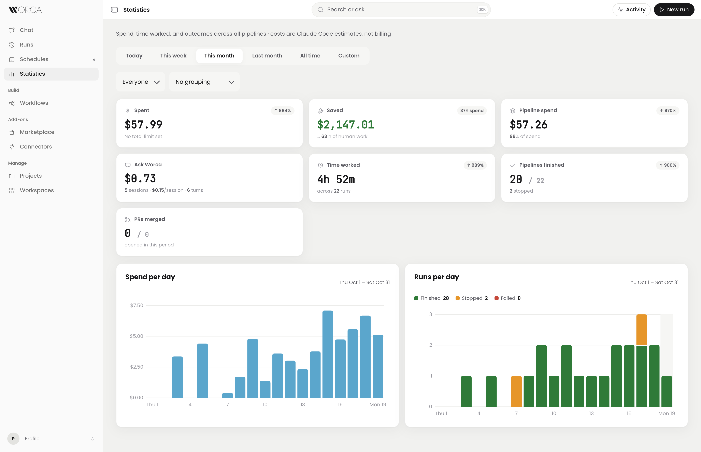

# Costs and budgets

What a run costs, where you see the spend, and the limits that stop a run before it costs too much.

## Spend and limits

### Cost on every run

The run page shows each run's estimated cost as it goes. In Expert mode, the workflow graph also shows the cost of
each step. These figures are Claude Code's client-side estimates, not your bill.

### Statistics

**Statistics** (Advanced) sums up spend over a range: Today, This week, This month, Last month, All time or a
Custom range. It shows:

- Spent
- Saved: estimated human hours × your developer rate, minus spend
- Pipeline spend and Chat
- Time worked
- Pipelines finished and PRs merged

Below the tiles, the *Spend per* and *Runs per* charts break it down by hour, day or month, with runs split into
finished, stopped and failed. You can filter or split spend by person, or by tag (see [Cost tags](#cost-tags)), and
export the split as CSV. More in [Statistics](statistics.md).

With a total limit set, a ring around your avatar in the sidebar fills toward it. It turns amber at 80% and red once
new runs are blocked. The account menu's spend card has the figures.

### Hard limits

Set limits in Settings › Runs › Budget & cost limits, or with `worca config`.

A per-pipeline cost limit pauses a runaway run before its next step. To lift it for that run, choose *Continue
without cap (this pipeline)* or run `worca resume <id> --ignore-cost-cap`.

A total cost limit counts pipeline and Chat spend over a window: weekly from Monday, or monthly from the 1st. Once
the limit is reached, running pipelines pause at their next step, and new runs, resumes and Ask turns are blocked
until the window resets or you raise the limit.

Workflow tests count too: their tries, and the AI checks of your criteria (Check the checker, suggested criteria and
clearer words included). Statistics leaves them out. A round of Check the checker makes three calls that each write a
whole copy of the good result's written text (never a project's diff), then 16 checks, so a long result costs more to check.
A copy that still holds what proved the criterion is asked for once more, so a round makes at most six copy calls. A result
whose text is over 40,000 characters is refused before any call. "Checking again … about $X" is what the round's own calls
cost, those asked once more included. Each call asked once more is a second paid call: a copy that still holds the proof,
and a check whose answer cannot be read or whose proof is not in the result. A result longer than 200,000 characters is
cut there before a criterion is checked on it, and the example's files and request after 100,000, so a very long result
costs no more than that. A test stops at its own cost limit (**Stop if the cost goes over**), tries and checks together
([Workflow tests](workflow-tests.md#test-a-version)).

Each model in "Checked with" names who pays for its checks, as far as Worca can tell: the credential broker; a cloud
(Vertex, Bedrock, Foundry), an API key or a sign-in token set in the model, where Worca runs or in your Claude Code
settings (an `apiKeyHelper` there included); a custom endpoint or the model's connection; or your Claude sign-in. Worca
cannot see managed Claude Code settings or a gateway in your network; with those, a check marked "Claude sign-in" may be
billed elsewhere. A check whose cost Worca cannot know is counted as $0, and the cost line of the test or of Check the
checker then adds "the cost of some checks is not known".

Team caps live in [Team policy](team-policy.md).

## Cost tags

Tags let you see what spend went where, for example per client. A tag is a `key:value` pair such as `client:acme`.
You add tags on New pipeline, on run pages and on Ask run cards, or with `--tag` on the CLI. Settings › Tags can
make some tags mandatory. Statistics and Team metrics then show spend **By tag**.
