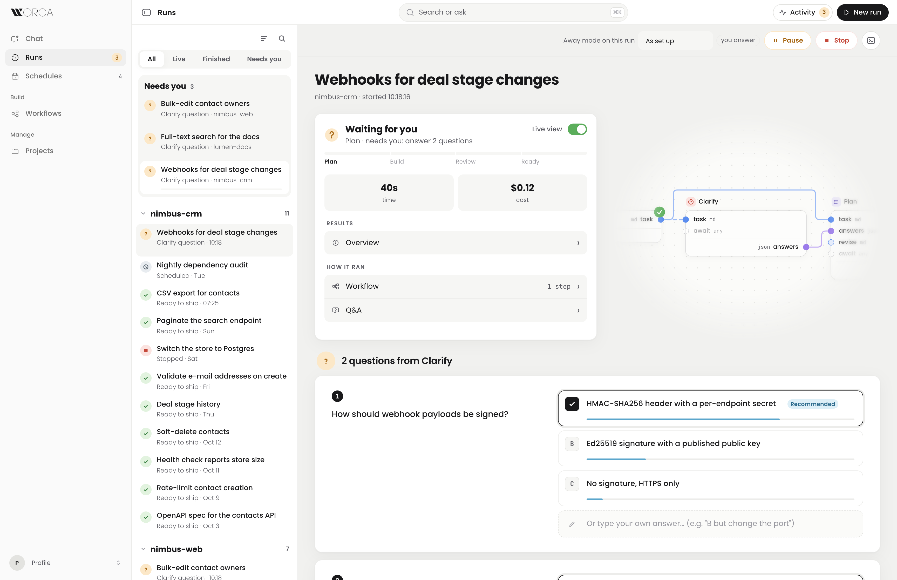
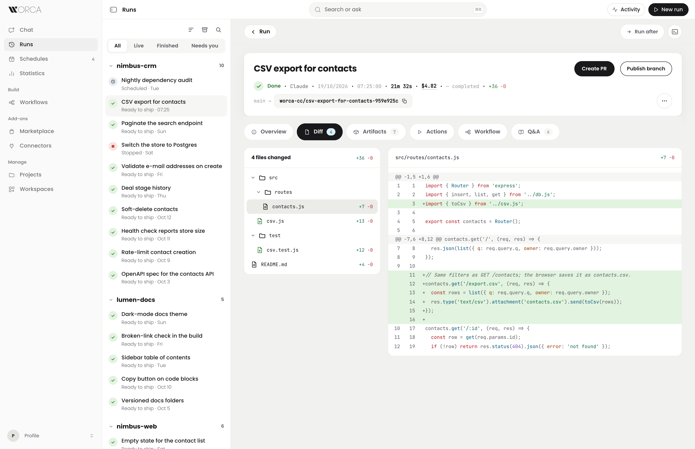
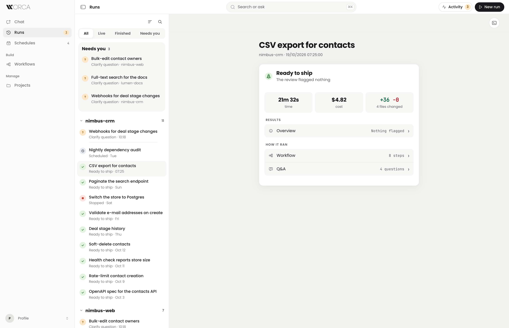

# Runs

A run takes your task through a workflow of agents and ends with work on its own branch. This page covers how
Worca picks the workflow, what the Default workflow does, and what a run gives you while it runs and after it
ends.

## Auto: Worca picks the workflow

You don't have to choose a workflow yourself. **Auto** is first in the New run **Workflow** picker and is
selected by default (`--workflow auto` on the CLI).

One model call reads the task text, any attached files and a small offline fingerprint of the repository. It may
also take a brief read-only look at the checkout. It then classifies the task: a free-form prompt, a partial plan
or a complete plan, how large the change is, and signals such as a big web UI feature.

Auto knows each agent only by its metadata and the front matter of its agent file, never its full instructions.
From those it assembles a workflow that fits the task. If a saved workflow already has exactly that shape, Auto
reuses it. Otherwise the proposal is saved as a new workflow once it's accepted.

With **Human in the loop** on (the default), you see the proposal first. You can **Accept & run**, **Revise** it in
plain text (Advanced and up), or **Cancel run**.

Turn the switch off (`--no-human`) and the proposal is accepted as it is, with no clarify step and no agent
questions. The run still pauses when a loop runs out of cycles, on a recovery prompt, at a cost cap or on an error.

To skip all of this, pick a saved workflow instead. Auto works for workspace runs too.

## The Default workflow

The built-in **Default** workflow hands your task to five agents:

1. **Clarify** asks before it assumes. It turns hidden decisions into up to 8 multiple-choice questions, each with
   2–4 options, free text and sometimes a recommended pick. When the task is clear, it asks nothing. The planner
   records your answers in the plan's `## Clarifications (Q&A)` section, so every later step sees them.
2. **Plan** explores the codebase and writes a design-level implementation plan: contracts (files, signatures, data
   and error shapes), invariants, the acceptance mapping and the test list, without full code bodies.
3. **Refine Plan** checks the plan against the real code in one read-only pass (no replay, no test runs) and writes
   `-v2`, at most 1.3× the size of the input.
4. **Implementation** follows the plan's contracts using TDD (red-green-refactor) and writes the code itself. It
   doesn't deviate from the plan, and records any deviation it is forced into.
5. **Review Implementation** reviews the git diff against the plan's contracts and invariants, and runs an
   adversarial pass (races, refusal paths, partial writes, trust boundaries) with severity floors. Blocking findings
   go back to the implementer, and the two loop until the review is clean.

The built-in **Lean** workflow skips Refine: Clarify → Plan → Implementation → Review, with one fix pass.

Refine runs once and continues with whatever it leaves open. The review loop has a cycle cap: 3 by default, and you
can change it per loop. When it reaches its cap with blocking findings left, the run pauses and lists the open issues. You choose **I approve another cycle**, or **Don't approve
another cycle and continue** with what you have.

Only `critical` and `major` findings block. `minor` findings and suggestions never do. When the run finishes, its
work is committed to its own `worca-cc/…` branch, ready for **Create PR**.

## A run's record

Every finished run keeps its full record, with one tab for each part:

- **Overview**: the review verdict and its findings, time and cost, and how many files changed.
- **Task**: the task the run was started with.
- **Diff**: every changed file with its +/− and patch. It takes line comments ([Diff comments](diff-comments.md)).
- **Artifacts**: the plans, reviews and other files the steps wrote.
- **Actions**.
- **Workflow**: the graph as it ran. At Expert it adds time and cost per step.
- **Q&A**: the clarify answers and any questions asked mid-run.
- **Logs**, and **Agents** at Expert.

Overview, Task, Diff, Workflow and Q&A show in Simple mode. Artifacts and Actions start at Advanced; Logs and Agents at Expert (a live run's page shows Logs at
Advanced). See [UI levels](ui-levels.md).

A run in a Folder project works on a copy of the folder. Instead of **Diff** and **Actions** it has **Changes**, at
every level, listing each file it added, updated or deleted. You land the work with **Apply to folder** or drop it
with **Discard**. Files that changed in the folder since the run started are skipped, and the dialog lists them.

A run with **No project** works in its own folder. It opens on **Artifacts** at every level and has no **Diff**,
**Changes** or **Actions**.

With [Workflow tests](workflow-tests.md) on (Labs), a run of one of your saved workflows uses the version marked in use, when there is
one, and records which version it used. The tries of a test are not runs you see here: they never appear in
the Runs list.

## Rerun a finished run

Open **⋯ › Rerun** on a run that is done, stopped or in error (an archived one too). **New run** opens filled in from
that run: its task and title, project or workspace, workflow, engine, guardrails, agent picks, Away mark, tags and the
files you attached. Nothing is created until you start it, so you can change anything first, and leaving the form
creates no run. The run you started from is never touched and never lists its reruns.

The new run's page has a **Rerun of …** row that links to the run it was copied from. If that run was deleted, the row
says so in plain text. A rerun of a rerun links to the run it was opened from, not the first one. A rerun you schedule
once keeps the link when it starts later; the runs of a repeating schedule are not linked. If the earlier run is
removed before you press **Start**, the form says so and keeps everything you filled in; press **Start** again to start
it as a new run, without the link.

On a run that is still going, paused or interrupted, **Rerun** is greyed with the reason; use **Resume** to continue
those.

What a rerun does not copy:

- The **feature branch** is not kept, so the form suggests a fresh one.
- Only the plain task text is copied, not a Markdown handoff or where the task came from.
- A run from before Worca kept run setups, a CLI start or a scan has no recorded settings: the form fills in the task
  and files, restores the run's workflow and guardrail set when they still exist, and says that the other settings are
  defaults.
- Files attached to a run that was **archived before** this feature cannot be recovered: Archive removes them, and the
  names were not kept. Later runs keep the names, so the form lists each file that is gone and starts without it.

If a model, workflow or guardrail set of the earlier run no longer exists, or its project is gone, the form names it and
holds Start until you use **Reset to default** or pick another project.

## Running, pausing and shipping

### A deterministic engine

A scheduler walks the workflow graph and decides what runs next. Agents do the creative work, but they never decide
the control flow. Every step, verdict, cost and artifact is recorded. More in [Architecture](ARCHITECTURE.md).

### Pause and resume, even across restarts

**Pause** parks a run, and so does a cost cap or a failing step. Only **Stop** ends one.

**Resume** picks the paused Claude sessions back up (`claude --resume`) in the same worktree, including any agent
work that wasn't committed yet. **Resume at…** schedules the resume instead: at a time, or after another run ends,
so paused runs can resume one after another.

A resume doesn't redo finished work. A task that already finished in the earlier attempt is not run again, and the
run's log says so. If its edits were taken away while the run was paused (a `git checkout .`, `git reset --hard` or
`git stash` in the worktree), the task runs again. A file you changed to something new yourself is left as you made it.

Paused runs survive a server restart. A run that was cut off mid-step comes back as *Interrupted*, and you can
resume it from its last clean point. A step that loses the network waits for it and retries by itself, and a run
parked by an outage resumes once the network is back.

### When an agent goes quiet

A step that produces no output for 20 minutes is stopped as idle, and you can change that limit per step or per
workflow (`idleLimitMinutes` in a step's config or in the workflow's `limits`; `WORCA_NODE_IDLE_LIMIT_MIN` sets the default for steps that set none). The limit no longer stops an agent that is busy: one waiting on a long job it started, such as a full test
suite or a build, gets another window as long as that job is still working. An agent that is waiting on nothing, or a
job that is stuck, is stopped as before.

### Isolated worktrees

Each run works in its own git worktree on its own `worca-cc/…` branch. Agents never edit your checkout, and runs
side by side don't collide. When a run ends, its work is committed to that branch and the worktree is removed. The
branch stays. A worktree isolates changes, not the host: natively, agents run as your user and can reach whatever
you can (see [Guardrails](guardrails.md)).

If agents read or wrote files outside the run's checkout, the run's page shows one quiet line under its banners, such as
"3 steps touched 4 files outside the checkout". It is information, not an error. Click **Details** to see the paths
grouped by step. The line turns amber when a path belongs to another run or session.

### Run on the source branch

Sometimes you want the result on your own branch, not a new one. Turn on **Run on the source branch** under the
feature branch (or pass `--on-source-branch`). The run still works on a hidden branch while it runs. When it
finishes `done`, Worca fast-forwards your source branch onto the result and deletes the hidden branch. The run's
page then offers **Push <source>** instead of a pull request.

Before a run starts, Worca can bring the source branch up to date with the remote ([Sync before run](sync-before-run.md)).

Worca only ever fast-forwards. If the source branch moved in the meantime, its checkout has uncommitted changes, or
the run didn't finish, the work stays on its own branch, and you get the commands to merge it yourself.

### Chat runs: source branch

A run proposed in a chat starts from the branch the chat names. When it names none, the setting **Chat runs: source
branch** (Settings › Runs) decides, and a project can override it under its Settings › Chat:

- **Ask me on the card** (the default): the run card shows its Source branch field at every interface mode, with
  "Pick a branch…" and a hint, and Start stays off until you pick one. A Start from Discord, Slack or Telegram of
  such a card answers "confirm in worca": open the chat in worca and pick the branch on the card.
- **Current (checked out)**: the run starts from the branch the project has checked out, as before. The card names it,
  for example "Current (checked out): feat/x".
- **Only when the chat names one**: the chat asks you which branch to use before it proposes the run.

Folder projects, folders that are not git repositories, and machines without git never need a branch. Worca checks
the setting again when you start or schedule the card, so a card proposed earlier follows the setting as it is now.

### Following runs live

**Runs** in the sidebar lists every run, live and finished. Its **View** menu shows All, Needs you, Running,
Waiting, Finished, **Ready to ship** (finished, no PR yet) or Archived, and groups runs by project or by date. More in [The Runs list](runs-list.md).

A live run's page shows its state and current step, the time ticking, its cost and the files it changed. **Live
view** shows the running step inside its workflow graph. **Diff** shows the worktree's changes so far. **Open in <Editor>** is at the top right (edits you make there go into the run). Each file's head, on live and finished runs, has an icon that opens the file at its first changed line; on a finished run that is not checked out, that one click checks it out first (see [Actions](actions.md#built-ins)). **Logs**
streams every step with search, and at Expert you can filter by source, level, step and cycle.

The top bar's **Activity** pill counts what needs you and what is running. To hear about it outside the tab, turn
on Settings › General › **Alerts** for desktop notifications and a tab badge when a run waits for you.

**Archived runs** (Advanced) lists deleted runs and lets you restore them.

#### Run time and agent time

A run's page shows its time in the **time** tile, ticking while the run works. This is the run clock: one second per
real second, with parallel steps counted once. The clock stands still while the run waits for you (a question, an
approval or a recovery prompt) and while it is paused, and it stops for good when the run ends. So a run that sat on
**Waiting for you** overnight doesn't show the night.

When steps ran side by side, a second tile, **agent time**, appears. It adds up every agent's own time, so it is larger
than the run time. Hover it for "Total time of all agents, parallel work added up". A run with no parallel work shows
only **time**. A run saved before Worca kept the clock shows its summed agent time as its time.

### One-click pull requests

A finished run's page offers **Create PR**. In the dialog you can edit the title, write the description or
**Generate** it, open the PR as a draft and turn on watching. Settings › Runs › **Pull requests** can draft the
description as soon as the dialog opens.

Worca then pushes the branch and opens the PR. On GitHub it uses the GitHub CLI (`gh`). On
[Azure DevOps](azure-devops.md) it uses a personal access token, and on [Bitbucket Cloud](bitbucket.md) an access
or API token. A run started from a GitHub issue closes the issue on merge, and a workspace run opens one linked PR
per changed repo. Afterwards the button becomes **View PR**. A workspace run's button reads **View PRs** and lists each
repository's PR; in the dialog, each repository row shows its own **View PR** link once its PR is open.

To push the branch without a PR, use **Publish branch** (Advanced). Once the branch has commits the remote doesn't,
the same button reads **Push changes** and sends them to the remote the branch is already on. A branch that already
has a PR never offers **Publish branch**.

#### Shipping from a fork

If you work in a fork, set **Push remote** in the Create PR dialog to your fork and **Into** to the repository that
owns the base branch (usually `upstream`). Worca pushes to your fork and opens the PR across the two repositories; the
line under the pickers shows the direction, for example `me:branch → up/repo main`. A remote cloned through an SSH host
alias counts as its real host. [Azure DevOps](azure-devops.md) and [Bitbucket Cloud](bitbucket.md) don't open PRs
between repositories yet: push to the base repository instead.

### Watch PR and conflicts

With **Watch PR** on, Worca reads the open PR about once a minute. A failing check, a merge conflict or a requested
change starts a fix run on the PR's branch, which pushes the fix.

After a run, Worca also checks whether the branch still merges into its base. If it does, you get **Update
branch**. If it conflicts, you get **Resolve in a pipeline** or **Resolve in a terminal**.

### Mock mode

To try Worca without spending anything, turn on **Mock mode** on New run (`--mock` on the CLI, or
`WORCA_MOCK=1` for a whole server). The pipeline runs against a deterministic offline mock, with no `claude` and no
tokens. It's meant for demos, development and CI.

