# One button scale: Shaper surfaces before and after

Every Shaper button sits on one scale: sm 28px, md 34px (the default) and lg 42px, with an 8px radius and a 1px border.
Hover tints the background and does not lift the button. Under a coarse pointer, every button is at least 40px tall.
`npm run verify:feature-page -- --out DIR` writes these clips: 1280px wide, scale 1.

| Surface | Before, light | After, light | Before, dark | After, dark |
|---|---|---|---|---|
| Feature page | 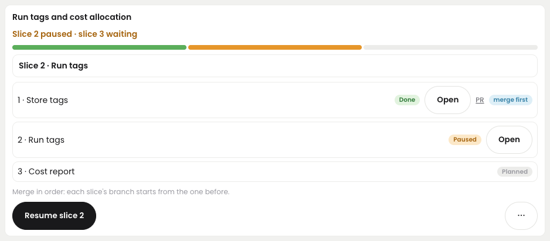 | 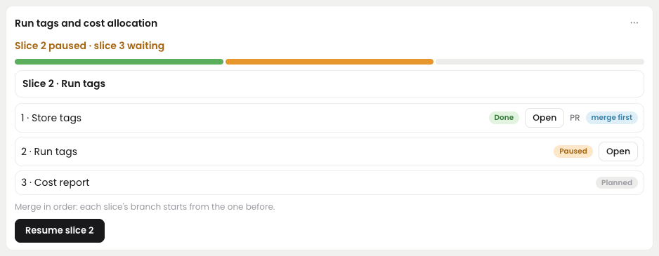 | 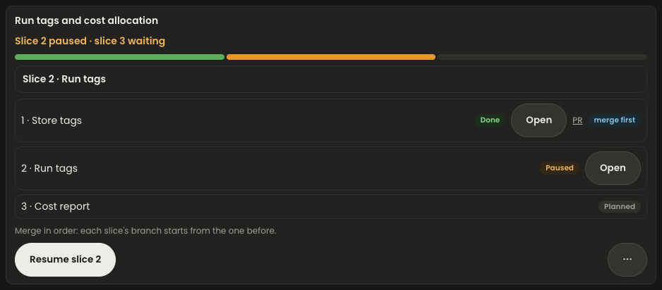 | 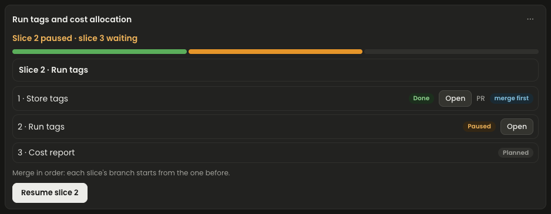 |
| Run page slice line |  |  |  |  |
| Gate | 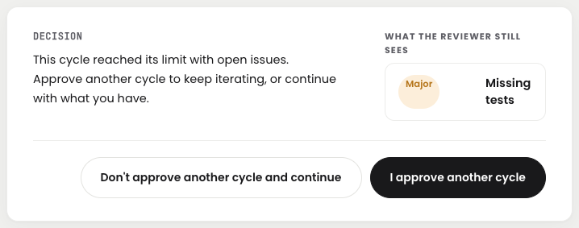 | 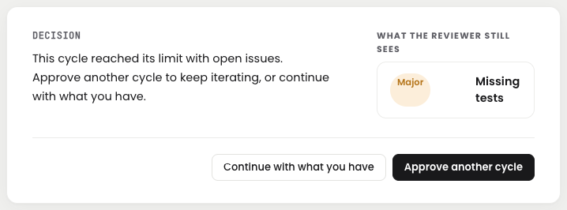 | 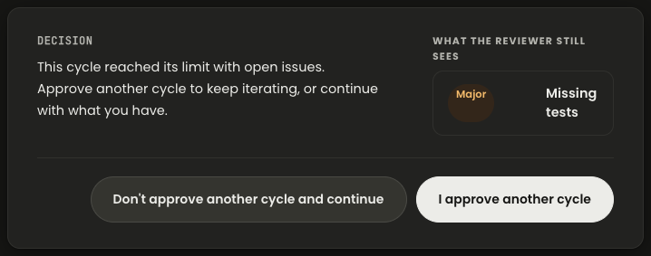 | 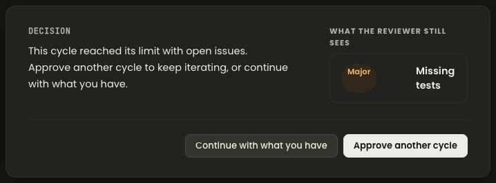 |
| Recovery | 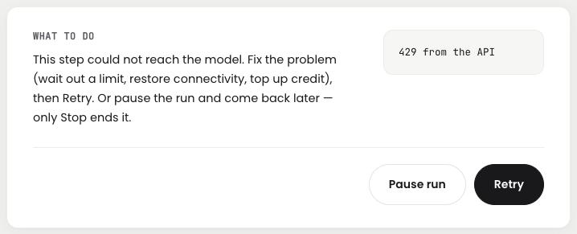 | 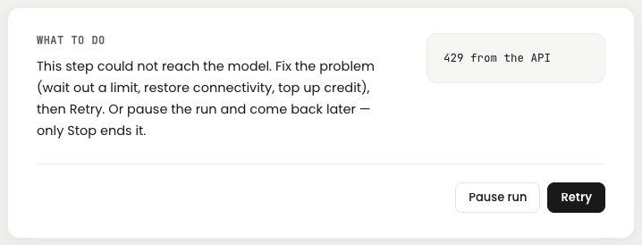 | 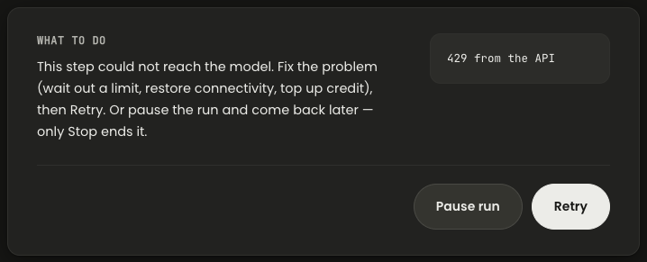 | 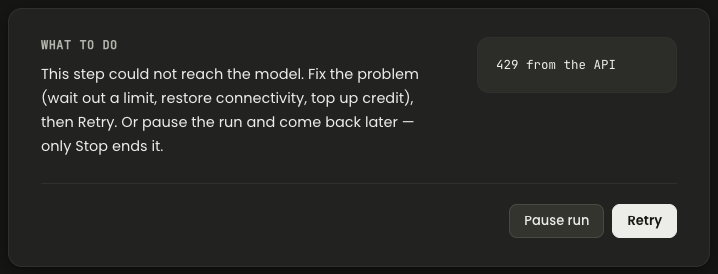 |
| Clarify questions | 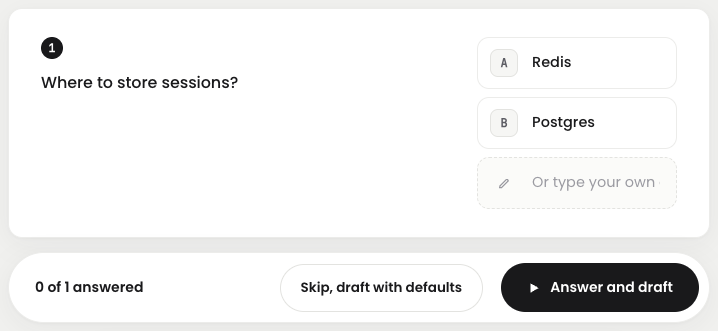 | 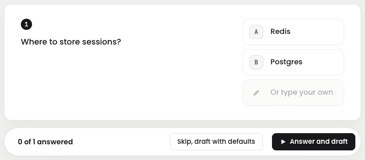 | 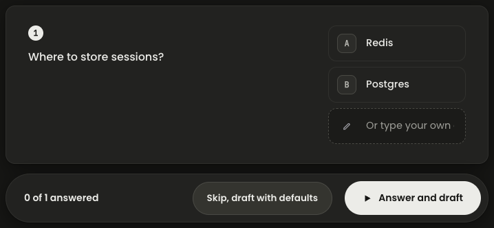 | 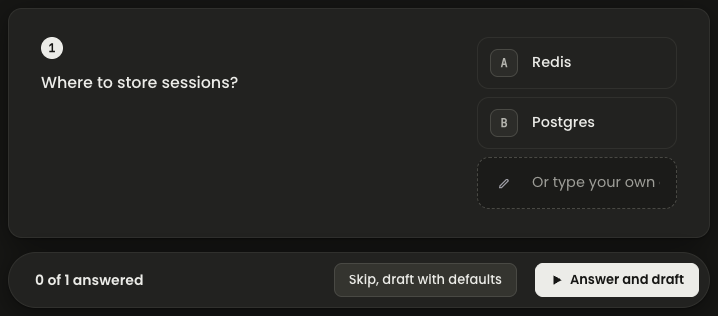 |
| Plan approval | 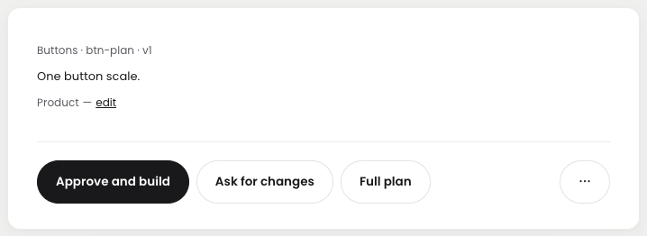 | 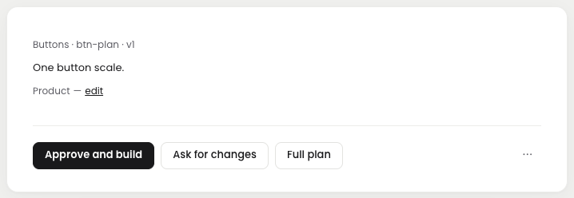 | 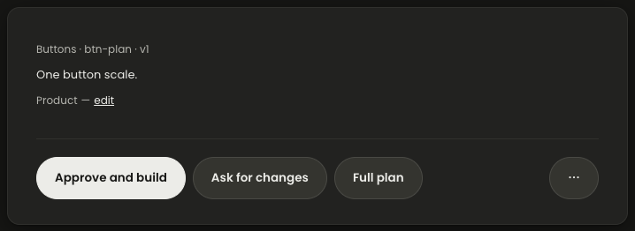 | 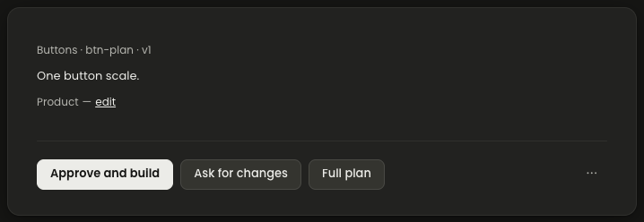 |
| Outline approval | 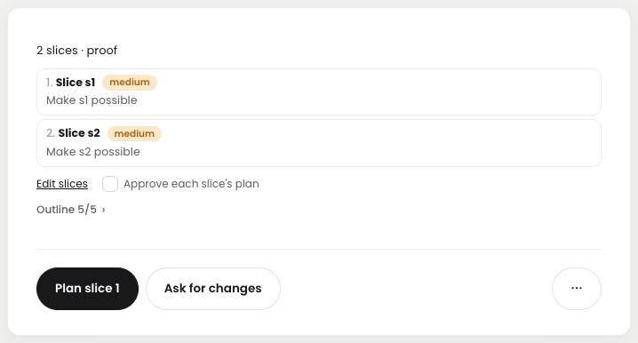 | 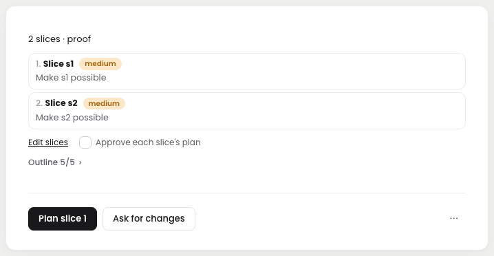 | 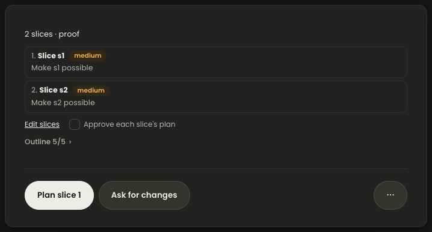 | 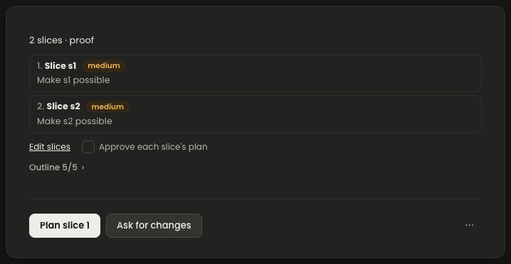 |
