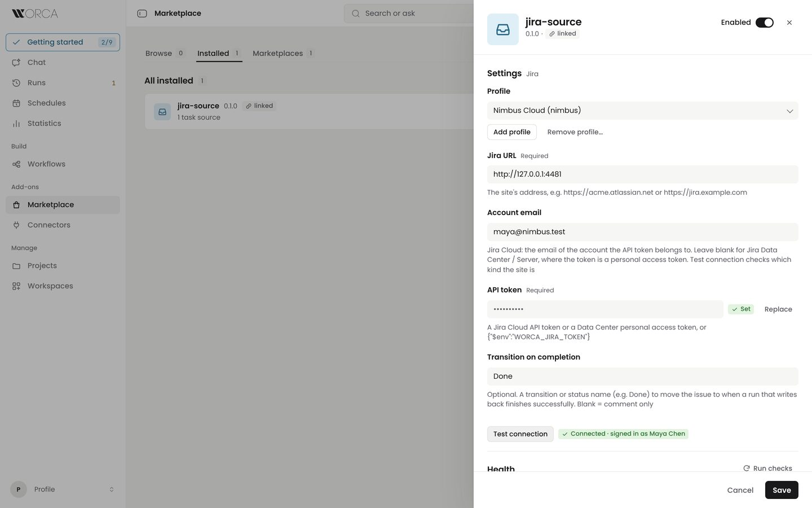
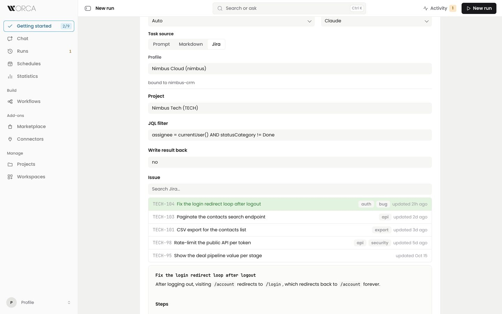

# jira-source (worca-cc plugin)

Pull tasks from Jira issues into worca-cc's New Pipeline, Ask Worca and
scheduled runs, and write results back as an issue comment (optionally moving
the issue through a named transition). Works with Jira Cloud and Jira Data
Center / Server.

## Install

    worca plugin install jira-source

## Setup

The source is **multi-profile**: add one profile per Jira site (Marketplace ›
Installed › jira-source › Profiles) and bind each project or workspace to the
profile its tickets live in. Each profile has its own settings and token.

| key | type | default | meaning |
|---|---|---|---|
| baseUrl | text | — | the site, e.g. `https://acme.atlassian.net` or `https://jira.example.com` |
| email | text | — | **Jira Cloud**: the email of the account the API token belongs to. Leave blank on **Data Center / Server** |
| token | secret text | — | a Jira Cloud API token, or a Data Center personal access token |
| transitionOnComplete | text | — | optional: a transition or status name (e.g. `Done`) to move the issue to when a run that writes back finishes successfully |

Authentication follows the email field: with an email the token is sent as
Basic `email:token` (Jira Cloud API tokens), without one as a Bearer personal
access token (Data Center / Server 8.14+).

Cloud and Data Center page search results differently, so the plugin asks the
site which it is (`/rest/api/2/serverInfo`, anonymously first, then with the
token) and remembers the answer per profile and URL. A Cloud site on a custom
domain is therefore handled like any other Cloud site. Only when the site does
not answer does the plugin guess from the hostname (`*.atlassian.net` and
`*.jira.com` are Cloud, the rest Data Center), and it asks again next time.

**Test connection** always asks afresh and checks the email field against the
answer: a Cloud site with no email, or a Data Center site with one, is named as
an email error before any token is tried.

The token is stored in
`~/.worca-cc/plugins/jira-source/data/secrets.json` (mode 0600, never in the
DB). Any of:

1. A token typed into the field. Jira Cloud:
   <https://id.atlassian.com/manage-profile/security/api-tokens>. Data Center:
   your avatar › Profile › Personal Access Tokens.
2. Environment indirection — set the field value to
   `{"$env":"WORCA_JIRA_TOKEN"}` and export `WORCA_JIRA_TOKEN` in the worca
   server's environment; the token never touches disk. With several sites,
   give each further profile its own `WORCA_JIRA_TOKEN_<NAME>`, e.g.
   `{"$env":"WORCA_JIRA_TOKEN_DC"}`.

The token needs to browse the projects you pick from and, for write-back, to
add comments and transition issues. A token is only as narrow as its account:
use an account that sees only what worca should.

### Why the token never reaches an agent

worca resolves `{"$env":…}` in its own host process when it reads the plugin
config, and hands the value to the connector in its config. Connector children
get only `PATH`, `HOME` and the proxy and CA variables. `WORCA_JIRA_TOKEN` and
every `WORCA_JIRA_TOKEN_<NAME>` are strip-only variables: worca removes them
from the environment of every claude, script, action and git call it spawns,
and never reads them itself.

If you point a profile at a variable with any other name, that variable stays
visible to the agents worca runs.

Verify with "Test connection" in the settings UI, or:

    worca plugin exec jira-source jira validateConfig

## Inputs

- **Project** — picked from the site's projects. Leave it empty to search
  across every project the filter matches.
- **JQL filter** — a JQL condition. worca wraps it into one query scoped to the
  chosen project, newest first:

      project = "<project>" AND (<your filter>) ORDER BY updated DESC

  An `ORDER BY` in your filter replaces the default order. The default,
  `assignee = currentUser() AND statusCategory != Done`, lists your open
  issues. Free text in the task browser adds `text ~ "<text>"`.
- **Write result back** — `no` (default) or `yes`, pinned on the run when it
  starts. Write-back is opt-in: only a run started with `yes` comments or
  transitions; a run with no value pinned is treated as `no`. Ask Worca fills
  in `no` unless you ask it to write back.
- **Issue** — picked in the task browser. Pasting a key (`SHOP-123`) or an
  issue URL (`…/browse/SHOP-123`, or a board link with `selectedIssue=`) skips
  the filter and fetches that one issue, whatever its state or project.

## Task ids

Task ids are issue keys, for example `SHOP-123`. The site comes from the
profile the run is bound to, which worca pins on the run, so the result is
always reported to the Jira the issue came from.

## Task body

The run's task is the issue's description and its comments, converted from
Jira's rendered HTML to markdown (the same on Cloud and Data Center).

## Write-back

When the run pinned **Write result back: yes**, every run result posts one
comment with the run summary and its links (the pull request, when there is
one), as Jira wiki markup.

With `transitionOnComplete` set and a successful run, the plugin first lists
the issue's available transitions and applies the first one whose name, or
whose target status, matches it (case-insensitive), then posts the comment with
a closing line saying what happened:

- `Moved to Done.`
- `Already in Done.` — nothing was changed.
- `Could not move to "Shipped" from "In Progress" (available: Start, Resolve).`
  — fix the setting; the run is not marked as a failed write-back.

If Jira refuses the transition itself (for example a required field on the
transition screen), the write-back fails before anything is posted, so a retry
from the results view posts the comment once.
